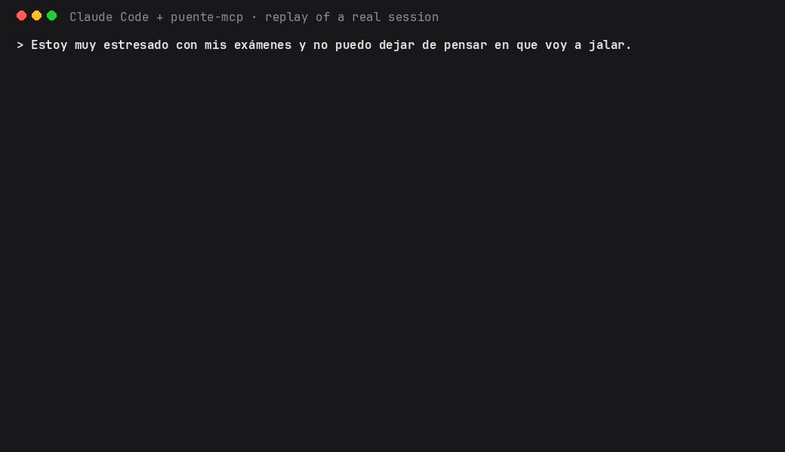

# Puente

A mobile "first barrier" support assistant for depression, for Spanish-speaking users in Peru.
It listens, suggests evidence-based activities, tracks mood over time and hands the person off to a
human (crisis lines, community mental-health centres, psychologists) when needed.

> Puente does not diagnose and is not a therapist. In a crisis in Peru, call **Línea 113, opción 5**
> (MINSA, free, 24/7) or **106** (SAMU).

[](https://github.com/Jaed69/puente-salud-mental/actions/workflows/ci.yml)

## Demo: any model, Puente's guardian and knowledge

Claude Code using the `puente-mcp` server. In the first scene it checks the message, searches the
WHO guide and cites the section and pages. In the second it detects a crisis and hands over the
Peru crisis lines. This is a replay of a real session, rendered from its transcript; only the
tool-loading step is left out.



## How a message flows

```text
message -> guardian (deterministic crisis check) --crisis--> Peru crisis lines, no LLM call
              | safe
              v
         hybrid retrieval (pgvector HNSW + Spanish full-text, fused with RRF; local embeddings)
              v
         companion LLM, told to cite only the numbered references it was given
              v
         citation check (only retrieved chunks count) -> guardian on the reply -> reply + sources
```

## Retrieval results

Measured on 60 Spanish questions labelled with the WHO guide's printed pages
(`apps/backend/eval/reports/retrieval-2026-11-24.md`, reproducible with `puente-knowledge eval`):

| Setup | Hit@1 | Hit@5 | MRR | p50 latency |
|-------|-------|-------|-----|-------------|
| jina-v2-base-es, hybrid (default) | 0.47 | 0.82 | 0.618 | 18 ms |
| multilingual-e5-large, hybrid | 0.47 | 0.78 | 0.587 | 44 ms |
| Spanish full-text only | 0.33 | 0.60 | 0.460 | 1 ms |

Hybrid search beat dense-only search for each of the three embedding models tested. With 60
questions, gaps of about 0.03 MRR are within noise; jina was chosen for being as good and smaller. Embeddings run
locally, so no user message leaves the server for retrieval (Peru's Ley 29733 treats it as
sensitive data).

## Architecture (target)

- **App:** Flutter (text first, voice later).
- **Backend:** Python, FastAPI, PostgreSQL + pgvector.
- **Agents:** empathetic companion, clinical RAG grounded on licensed lay material, and a guardian
  that checks every user message and every reply. Crisis detection is deterministic first and never
  depends on an LLM being available.

## Run it locally

Requires Docker. From the repository root:

```sh
docker compose up -d --build     # db + one-shot knowledge ingestion + API
curl http://127.0.0.1:8000/ready # 503 "starting" until the embedding model is downloaded
```

- The API listens on `http://127.0.0.1:8000` (`POST /v1/messages`). `PUENTE_API_BIND=0.0.0.0`
  exposes it to the local network for a phone in development. The API has no authentication yet,
  so use it only on a trusted network and with synthetic conversations.
- The API starts without waiting for the database or the ingestion, so the guardian and the
  crisis response always work. Grounding starts once `ingest` has loaded the chunks.
- To get real replies, configure the companion model in `apps/backend/.env` (see
  `apps/backend/README.md`). Without it the API serves a fixed fallback reply. The guardian and
  the crisis response work either way.
- Without Docker, run the backend with uv (`apps/backend/README.md`) and the app with Flutter
  (`apps/mobile/README.md`).

## What works today

- Guardian layer 1: deterministic crisis detection on every message and every reply. It fails
  closed and returns Peru crisis lines.
- Companion: any OpenAI-compatible chat model, behind the guardian.
- Clinical RAG: WHO's "En tiempos de estrés, haz lo que importa" (Spanish, CC BY-NC-SA 3.0 IGO),
  with local embeddings and hybrid search on PostgreSQL + pgvector. Replies cite their sources, and
  the backend checks every citation. See `apps/backend/eval/reports/` for the retrieval
  evaluation.
- Flutter app: chat, crisis card with tap-to-call, offline SOS screen.
- MCP server (`puente-mcp`): the guardian, the crisis resources and the WHO guidance search as
  tools for any MCP client and any model. See `apps/backend/README.md`.

## Layout

- `apps/backend` — FastAPI service.
- `apps/mobile` — Flutter app.
- `docs/research` — research report and notes behind the design decisions.
- `odd/tasks` — feature documents with tasks, checks and progress.
